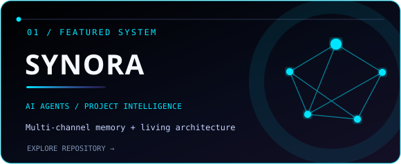
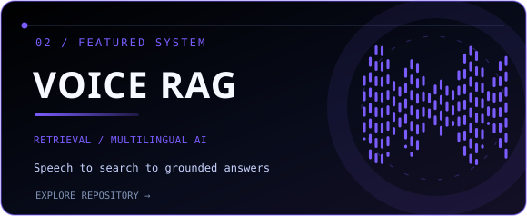
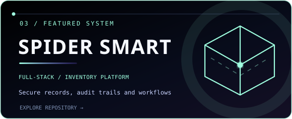
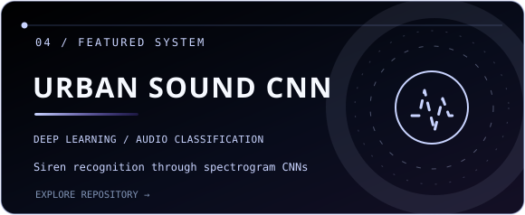
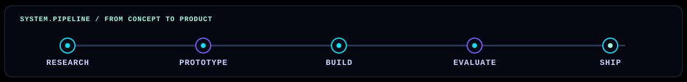

<!--
  RATNADEEP PATIL / PROFILE README
  Visual identity: #000000 / #00E5FF / #7A5CFF / #C9D4FF / #9FFFE0
  Custom animated SVGs live in ./assets/ (tracked in this repository).
  Their static first frames remain useful if motion is disabled.
-->

<div align="center">

<a href="https://github.com/Ratnadeep-2007">
  
</a>

<br />


<br />

<a href="https://github.com/Ratnadeep-2007?tab=followers"></a>
<a href="https://github.com/Ratnadeep-2007?tab=repositories"></a>

</div>

---

### `01 / WHO.AM.I`

> **I build at the intersection of AI, software engineering, and useful products.**
>
> From project-aware AI agents and multilingual retrieval to full-stack applications, I enjoy connecting the research side of machine learning with the engineering needed to make it work in the real world.

```python
class Developer:
    name = "Ratnadeep Patil"
    focus = ["AI Agents", "RAG", "Machine Learning", "Full-Stack"]
    building_with = ["Python", "FastAPI", "React", "TypeScript", "PostgreSQL"]

    def philosophy(self):
        return "Research thoughtfully. Build practically. Keep improving."
```

<table>
  <tr>
    <td width="50%" valign="top">
      <b>⚡ Currently exploring</b><br />
      Long-term AI memory, retrieval-augmented generation, multimodal workflows, and autonomous agents.
    </td>
    <td width="50%" valign="top">
      <b>🧩 What I enjoy building</b><br />
      AI-backed products, developer tools, machine-learning experiments, and end-to-end web applications.
    </td>
  </tr>
</table>

### `02 / TECH.EXPERIENCE`

<div align="center">

**Languages · Interfaces · Infrastructure**


<br /><br />


</div>

---

### `03 / FEATURED.SYSTEMS`

<div align="center">

*Selected work across intelligent agents, retrieval, full-stack systems, and deep learning.*

</div>

<table>
  <tr>
    <td width="50%" valign="top">
      <a href="https://github.com/Ratnadeep-2007/Synora"></a>
      <p><b>Living knowledge for real projects.</b><br />Ingests Google Meet, WhatsApp, and direct uploads to organize project evidence, contextual memory, and evolving Excalidraw architecture.<br /><sub>FastAPI · Next.js · Semantic retrieval · Project memory</sub></p>
    </td>
    <td width="50%" valign="top">
      <a href="https://github.com/Ratnadeep-2007/Voice-Enabled-RAG-MSMARCO-XI"></a>
      <p><b>Ask questions with your voice.</b><br />A multilingual, voice-enabled retrieval system combining speech-to-text, dense embeddings, Qdrant, and evidence-grounded generation.<br /><sub>Python · Qdrant · Multilingual embeddings · RAG</sub></p>
    </td>
  </tr>
  <tr>
    <td width="50%" valign="top">
      <a href="https://github.com/Ratnadeep-2007/SpiderSmartSolution"></a>
      <p><b>Full-stack software with traceability.</b><br />Inventory management with authentication, metadata records, audit trails, and record versioning.<br /><sub>React · TypeScript · FastAPI · Supabase</sub></p>
    </td>
    <td width="50%" valign="top">
      <a href="https://github.com/Ratnadeep-2007/urban-sound-binary-cnn"></a>
      <p><b>Teaching a model to recognize sound.</b><br />A CNN mini-project that classifies UrbanSound8K recordings as siren or non-siren using mel-spectrograms.<br /><sub>Python · CNN · Audio classification · Jupyter</sub></p>
    </td>
  </tr>
</table>

<div align="center">

**More things I've built**

[**NLP Experiments**](https://github.com/Ratnadeep-2007/NLP) · [**Solar Document Automation**](https://github.com/Ratnadeep-2007/multi_doc_writer) · [**All Repositories ↗**](https://github.com/Ratnadeep-2007?tab=repositories)

</div>

---

### `04 / GITHUB.TELEMETRY`

<div align="center">


<sub>Dynamic statistics are generated by a third-party service and can be temporarily unavailable.</sub>

</div>

---

### `05 / ENGINEERING.MINDSET`

<div align="center">



**Building intelligent systems that people can actually use.**

<a href="https://github.com/Ratnadeep-2007?tab=repositories"></a>

<sub><b>AI · ENGINEERING · CURIOSITY · ITERATION</b></sub>

</div>
